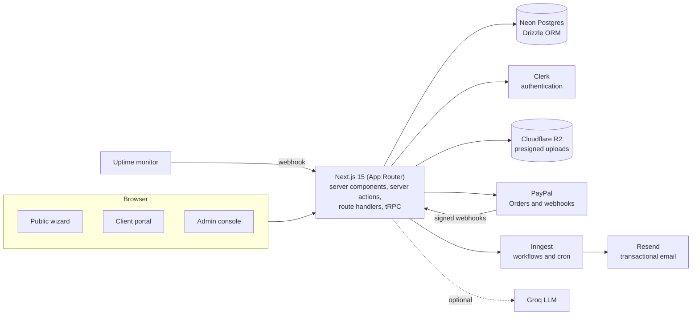
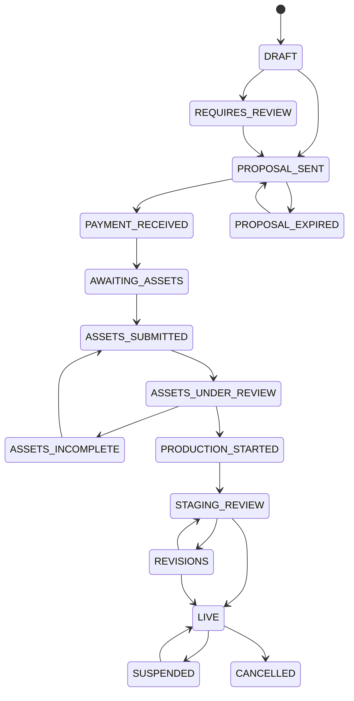

# waas-platform

[](https://github.com/XavierQuirico/waas-platform/actions/workflows/ci.yml)

A **Website-as-a-Service** platform built for QUIRICO STUDIOS, a web studio in the Dominican Republic that sells professional websites as a monthly subscription (BASIC, PRO and BUSINESS plans) and as fixed-price custom builds (LEGACY).

The platform runs the entire customer journey in one codebase: a public intake wizard, a quote calculator, payment, asset collection, production, staging review, go-live, and ongoing billing, support and change requests. It has three surfaces — a public site, a client portal and an admin console — backed by a typed API, durable background workflows and transactional email.

> The product interface is in Spanish (its market). Code, tests and documentation are in English where practical.

## Live demo

**https://waas-platform-demo.vercel.app** — a sandbox deployment running on its own isolated services (a separate Neon database, a separate Clerk application and a PayPal Sandbox app). Every record in it is fictional.

| Role | Email | Password | What to look at |
| --- | --- | --- | --- |
| Client | `ana.demo@example.com` | `vOosXUQSyxikAa7!8ea3b2` | Portal dashboard, project timeline, staging review and feedback, requests, billing |
| Admin | `admin.demo@example.com` | `GzE9oDKfxareAa7!0859f3` | Project queue, asset review, quote calculator, catalog, billing overview |

You can also try the public intake wizard at `/empezar` without signing in.

What the demo leaves out, on purpose:

- **File uploads are off** (no storage bucket is attached), so the materials step cannot upload files.
- **Background workflows and email are off** (`INNGEST_DISABLED`, `EMAIL_DRY_RUN`): actions complete, but no follow-up jobs run and nothing is sent.
- **AI suggestions use the deterministic fallback** (no LLM key is configured).
- **PayPal runs against the Sandbox**, so no real money moves.

The data may be reset at any time. Please do not enter personal information.

## Highlights

- **Explicit project lifecycle.** A 17-state machine governs every project; every transition is validated and every write is conditional on the state that was read, so concurrent or repeated events cannot corrupt a project.
- **Authorization you can test.** Clerk sessions, a client → project ownership chain on every portal query, and a single admin guard. Server actions are public endpoints, so each one checks its own role — and a contract test fails the build if a new admin action forgets to.
- **Money handled carefully.** Pure, unit-tested pricing functions (PayPal fee gross-up, volume discounts that do not stack, a hard floor, 50/25/25 installments). PayPal amounts are parsed and compared in integer cents.
- **Webhooks done properly.** PayPal signatures are verified against PayPal's API (rejecting unverifiable events in production); events are logged idempotently; state updates are conditional. The uptime webhook uses a shared secret compared in constant time.
- **Defense in depth.** Content-Security-Policy and other security headers, per-IP rate limiting on public endpoints, constrained presigned uploads to R2, Zod validation at the API boundaries.
- **AI where it helps, never required.** An LLM (Groq) interprets free-text briefs and suggests add-ons; output is validated with Zod and every feature has a deterministic fallback.
- **Builds without secrets.** Database, email and storage clients are created lazily, so `npm run build`, the tests and CI need no credentials.

## Architecture



### Project lifecycle



Any non-terminal state can also move to `CANCELLED`; LEGACY projects end in `CLOSED`.

## Features

**Public** — a 7-step intake wizard with draft autosave, brief interpretation and server-side plan detection; sign-in resolves each person to the right surface by role.

**Client portal** — dashboard with human-readable project status; material upload checklist (direct-to-R2 uploads); staging review with approval or structured feedback; change requests with quotes and PayPal checkout; incidents; billing and maintenance views; account settings.

**Admin console** — project queue and detail with asset review and proposal editing; a deterministic quote calculator with optional AI suggestions; commercial catalog administration; manual payment registration; tickets, incidents, notifications and reminders; billing and MRR overview; SEO report approval.

**Workflows** — 16 Inngest functions covering onboarding, reminders, payment-failure grace and suspension, SEO checks and weekly summaries, with 20 email templates.

## Tech stack

| Area | Choice |
| --- | --- |
| Framework | Next.js 15 (App Router), React 19, TypeScript |
| API | tRPC 11 (superjson), server actions, route handlers |
| Auth | Clerk |
| Data | Neon Postgres, Drizzle ORM |
| Payments | PayPal Orders and subscription webhooks |
| Jobs and email | Inngest, Resend, React Email |
| Storage | Cloudflare R2 (S3-compatible, presigned uploads) |
| Styling | Tailwind CSS, GSAP |
| Quality | Vitest, Playwright, ESLint, GitHub Actions |
| Observability | Sentry |

## Getting started

Requirements: Node.js 20.9 or later, a Neon database and a Clerk application. Every other service is optional for local development (see [`.env.example`](.env.example)).

```bash
npm install
cp .env.example .env.local      # then fill in the values
npm run db:migrate              # apply the schema
npm run seed:catalog            # load the commercial catalog
npm run seed                    # optional: demo projects, incidents and a quote
npm run dev
```

Useful scripts:

| Script | Purpose |
| --- | --- |
| `npm run dev` / `build` / `start` | Run, build and serve the app |
| `npm run typecheck` / `lint` | Static checks (both run in CI) |
| `npm test` / `test:coverage` | Unit tests, with or without coverage |
| `npm run test:e2e` | Playwright tests that need no login |
| `npm run test:e2e:full` | Authenticated end-to-end tests (needs test users) |
| `npm run db:generate` / `db:migrate` | Create and apply migrations |

## Testing

- **Unit tests (Vitest)** — 1,614 tests in 53 files, all of them exercising behavior: state machine and transitions, pricing, authorization, webhooks, uploads, the tRPC transport contract, catalog rules and portal view models.
- **End-to-end (Playwright)** — 132 tests in 17 specs covering the wizard, route protection, portal flows and admin isolation.
- **CI** — type check, lint, unit tests with coverage and a production build on every push and pull request.

Coverage of the logic layers (`src/lib`, `src/server`, `src/inngest`, `src/app/api`) is about 50 % of lines. It is concentrated where the business rules live:

| Module | Line coverage |
| --- | --- |
| security helpers | 97 % |
| project state machine | 95 % |
| routing | 93 % |
| SLA and business hours | 91 % |
| commercial catalog | 90 % |
| ticket billing | 89 % |
| client portal | 84 % |
| pricing calculator | 52 % |

## Project layout

```
src/
  app/            routes: (public) wizard, (portal) client, admin, api
  components/     shared UI
  db/             Drizzle schema, migrations and seeds
  emails/         React Email templates
  inngest/        background workflows
  lib/            domain logic (catalog, calculator, intake, portal, projects, sla, tickets, security…)
  server/         tRPC routers
tests/e2e/        Playwright specs
scripts/          seed and test-run helpers
```

## Status and known limitations

This is a working product that is still being completed. Said plainly:

- **Subscription checkout is not wired end to end.** The webhook handlers and the checkout component exist and the confirmation endpoint is hardened, but creating a subscription from an accepted proposal is still pending. Today, change requests are paid through PayPal Orders and recurring plans are registered by an admin.
- **Reactivation after payment is manual.** A suspended project is reactivated from the admin console; automatic reactivation on a successful payment is not implemented.
- **Background workflows have no automated tests**, and the API routes and tRPC routers are only partly covered. The pure domain logic is where the coverage is.
- **Rate limiting is in memory**, per server instance. For a global guarantee, pair it with an edge rate limit.
- **Peer dependency override.** `@react-email/components` 0.0.x declares React 18 as a peer; `.npmrc` sets `legacy-peer-deps` until those packages are upgraded.

## Security

- Portal queries resolve the caller's client and project from the session and check ownership; resource IDs sent by the browser are not trusted on their own.
- Admin actions run a shared role guard before doing any work, and a test fails if one is missing.
- Secrets live only in environment variables; see [`.env.example`](.env.example).

## License

Copyright © 2026 Xavier Quirico. All rights reserved. This code is published for evaluation only; see [LICENSE](LICENSE).

## Author

**Xavier Quirico** — QUIRICO STUDIOS · [GitHub](https://github.com/XavierQuirico) · [LinkedIn](https://linkedin.com/in/xavierquirico)
