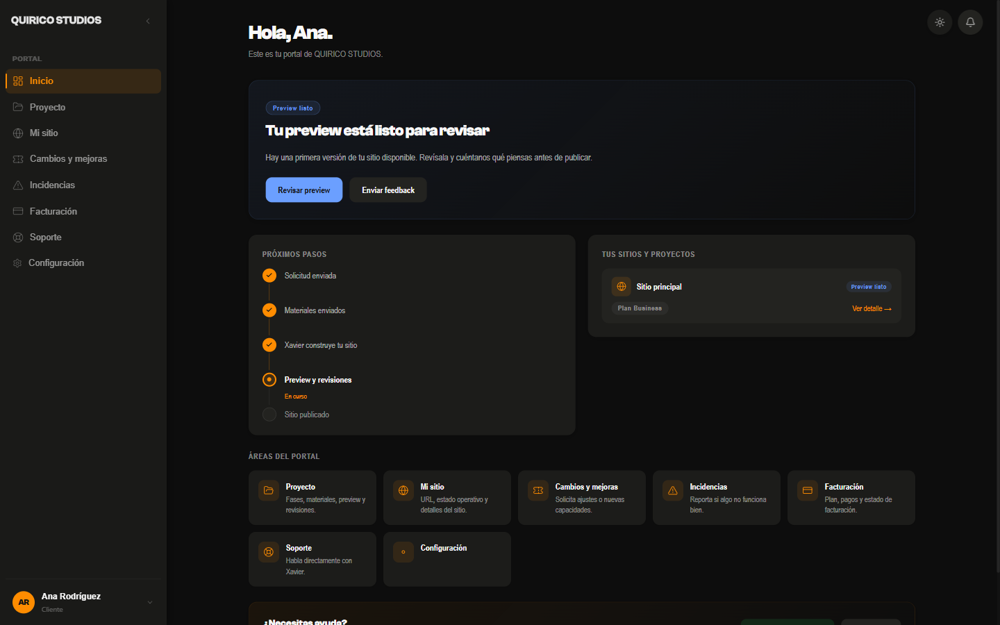
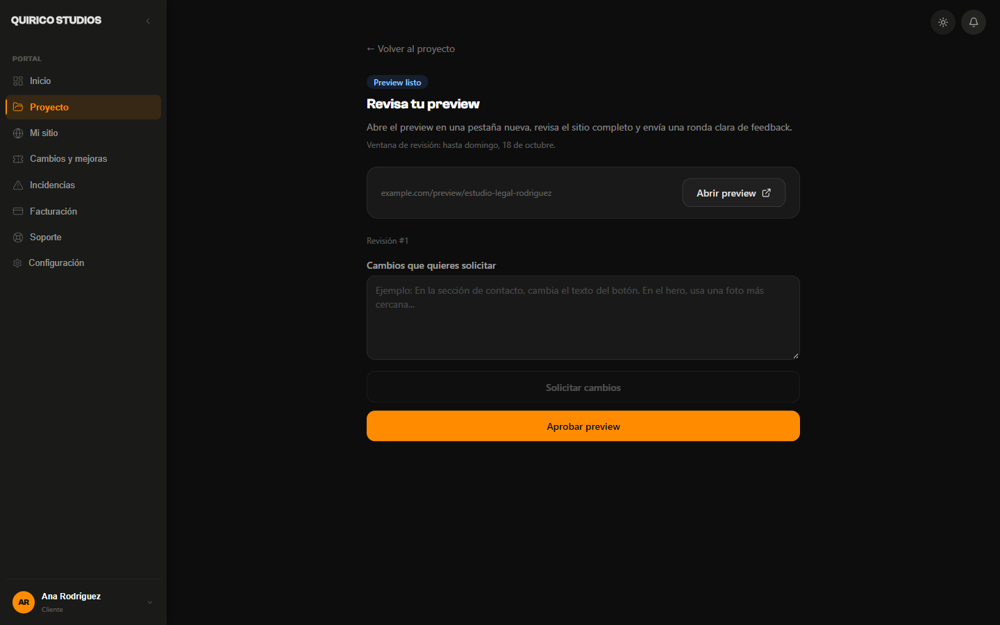
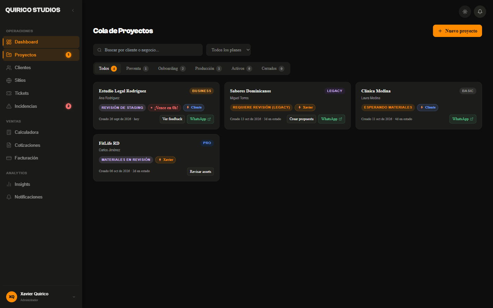
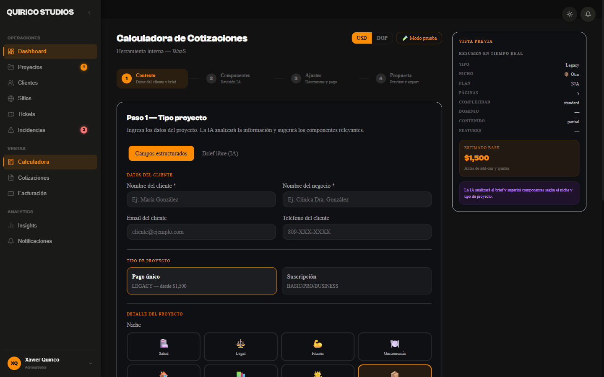
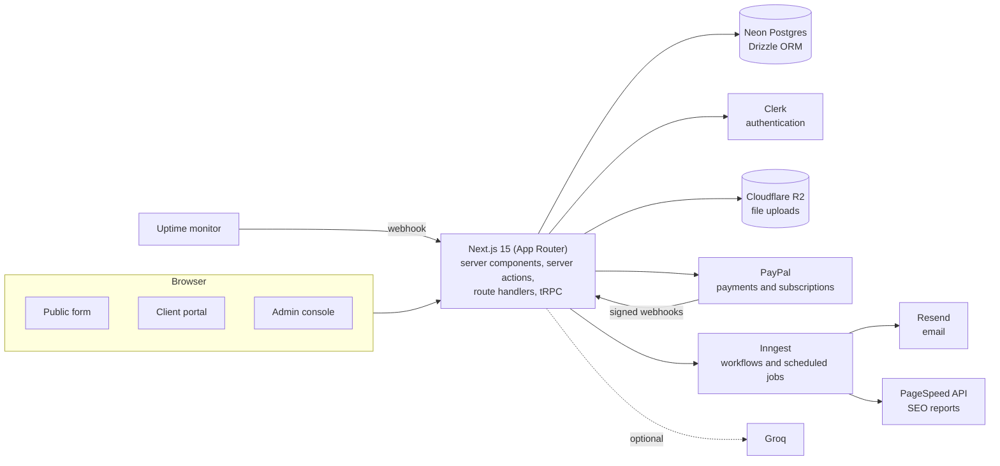
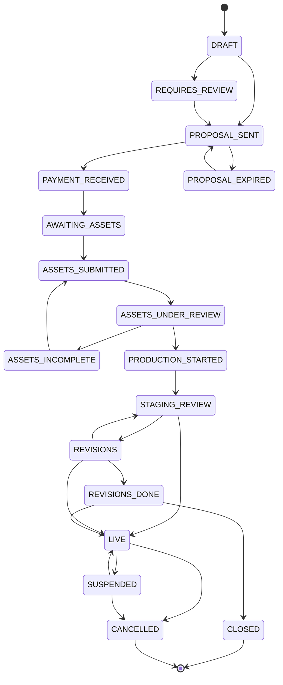

# waas-platform

[](https://github.com/XavierQuirico/waas-platform/actions/workflows/ci.yml)

This is the system I built for QUIRICO STUDIOS, my web studio in the Dominican Republic. I sell websites as a monthly subscription (BASIC, PRO and BUSINESS plans) or as a one-time project (LEGACY), and I wanted the whole process in one place instead of juggling emails and spreadsheets.

It covers the full customer path: a person fills in a form, gets a proposal, pays, uploads their materials, reviews a preview of the site, approves it, and keeps using the portal afterwards for billing, support and change requests. There are three parts: a public form, a client portal and an admin console.

It isn't finished. What's missing is listed at the bottom under "What's not done".

The interface is in Spanish because that's my clients' language. The code and docs are in English.

## Live demo

**https://waas-platform-demo.vercel.app**

It runs on services separate from my own (its own Neon database, its own Clerk app and PayPal in Sandbox mode). All the data is made up.

| Role | Email | Password |
| --- | --- | --- |
| Client | `ana.demo@example.com` | `vOosXUQSyxikAa7!8ea3b2` |
| Admin | `admin.demo@example.com` | `GzE9oDKfxareAa7!0859f3` |

You can also try the public form at `/empezar` without signing in.

What the demo doesn't do: file uploads (no storage is attached), sending emails and running background jobs, and the AI suggestions use fixed rules instead of the model. PayPal is in Sandbox, so no real money moves. The data can be reset at any time, so please don't enter personal information.

## Screenshots

| Client portal | Preview review |
| --- | --- |
|  |  |

| Project queue (admin) | Quote calculator (admin) |
| --- | --- |
|  |  |

## What I paid the most attention to

- **An explicit project lifecycle.** Every project moves through 17 states and only certain transitions are allowed. Each database update only applies if the project is still in the state that was read, so a repeated event or two actions at once can't leave it broken.
- **Permissions you can test.** Server actions are public endpoints, so every admin action checks the role itself. A test walks through all of them and fails if a new one skips the check.
- **Careful with payments.** Amounts are compared in whole cents. PayPal webhooks are verified against PayPal's API and logged idempotently. The uptime monitor webhook uses a shared secret.
- **Security basics done properly.** CSP and other security headers, rate limiting on public endpoints, restricted uploads to R2, and Zod validation at the edges.
- **Optional AI.** A model (Groq) reads the free text in the form and suggests add-ons for quotes. Its output is validated, and everything has a fallback that works without it.
- **Builds without secrets.** The database, email and storage clients are created when first used, so the build, the tests and CI don't need credentials.

## How it's put together



### Project lifecycle



Almost any active state can also go to `CANCELLED`. I only drew that arrow from `LIVE` and `SUSPENDED` to keep the diagram readable. `CLOSED` is where one-time LEGACY projects end once they're delivered. When a payment fails, the project stays `LIVE` for a 3-day grace period and then moves to `SUSPENDED`.

## What's included

**Public:** a 7-step form that saves a draft, reads the client's free text and works out which plan fits.

**Client portal:** a home page with the project status in plain language, a checklist of materials to upload, preview review (approve or ask for changes), change requests with a quote and payment, incidents, billing, maintenance and account settings.

**Admin console:** project queue, materials review, a quote calculator with optional AI suggestions, a service catalog, manual payment entry, tickets, incidents, notifications, a billing overview and SEO report approval.

**Background jobs:** 16 Inngest functions (welcome flow, reminders, payment failures and suspension, SEO checks, weekly summaries) and 20 email templates.

## Tech stack

| Area | What I used |
| --- | --- |
| Framework | Next.js 15 (App Router), React 19, TypeScript |
| API | tRPC 11, server actions, route handlers |
| Auth | Clerk |
| Data | Neon Postgres, Drizzle ORM |
| Payments | PayPal (one-time payments and subscription webhooks) |
| Jobs and email | Inngest, Resend, React Email |
| Files | Cloudflare R2 |
| Styling | Tailwind CSS, GSAP |
| Quality | Vitest, Playwright, ESLint, GitHub Actions |
| Monitoring | Sentry |

## Running it locally

You need Node.js 20.9 or later, a Neon database and a Clerk app. Everything else is optional locally (see [`.env.example`](.env.example)).

```bash
npm install
cp .env.example .env.local      # fill in your values
npm run db:migrate              # create the tables
npm run seed:catalog            # load the service catalog
npm run seed                    # optional: sample projects
npm run dev
```

Useful scripts:

| Script | What it does |
| --- | --- |
| `npm run dev` / `build` / `start` | Run, build and serve |
| `npm run typecheck` / `lint` | Static checks (CI runs both) |
| `npm test` / `test:coverage` | Unit tests, with or without coverage |
| `npm run test:e2e` | Playwright tests that don't need a login |
| `npm run test:e2e:full` | Full tests with a login (need test users) |
| `npm run db:generate` / `db:migrate` | Create and apply migrations |

## Tests

- **Unit (Vitest):** 1,623 tests in 55 files. They test behavior: the state machine, pricing, permissions, webhooks, uploads, the tRPC contract, catalog rules and portal logic.
- **End to end (Playwright):** 135 tests in 17 files. They cover the form, route protection, the portal and admin isolation.
- **CI:** every push runs typecheck, lint, tests with coverage and a production build.

Overall coverage of the logic layers (`src/lib`, `src/server`, `src/inngest`, `src/app/api`) is about 50% of lines. It's concentrated where the business rules live:

| Module | Line coverage |
| --- | --- |
| Security | 97% |
| Project state machine | 91% |
| Routing | 94% |
| SLA and business hours | 91% |
| Catalog | 90% |
| Ticket billing | 89% |
| Client portal | 84% |
| Pricing calculator | 52% |

## Project layout

```
src/
  app/            routes: public form, client portal, admin, api
  components/     shared UI
  db/             Drizzle schema, migrations and seeds
  emails/         email templates
  inngest/        background jobs
  lib/            domain logic (catalog, calculator, portal, projects, SLA, tickets, security…)
  server/         tRPC routers
tests/e2e/        Playwright tests
scripts/          seeds and test helpers
```

## What's not done

It's a working product that I'm still finishing. What isn't there yet:

- **Creating the subscription from an accepted proposal.** The webhooks and the checkout component exist and the confirmation endpoint is locked down, but the step that creates the subscription isn't wired up. Today change requests are paid through PayPal, and I register the recurring plans myself from the admin.
- **Reactivating a project when the client pays.** I reactivate a suspended project by hand from the admin. Automatic reactivation isn't built.
- **Tests for the background jobs.** The tRPC routers and API routes are only partly covered. The pure logic is the best-tested part.
- **In-memory rate limiting.** It works per server instance. For a global limit it needs an edge rate limit on top.
- **React Email dependencies.** The 0.0.x versions ask for React 18, so `.npmrc` uses `legacy-peer-deps` until I upgrade them.

## Security

- Portal queries take the client and project from the session and check ownership. They don't trust IDs sent by the browser.
- Admin actions check the role before doing anything, and a test fails if that check is missing.
- Secrets live only in environment variables (see [`.env.example`](.env.example)).

## License

Copyright © 2026 Xavier Quirico. All rights reserved. The code is published for evaluation only; see [LICENSE](LICENSE).

## Author

**Xavier Quirico** · QUIRICO STUDIOS · [GitHub](https://github.com/XavierQuirico) · [LinkedIn](https://linkedin.com/in/xavier-quirico)
